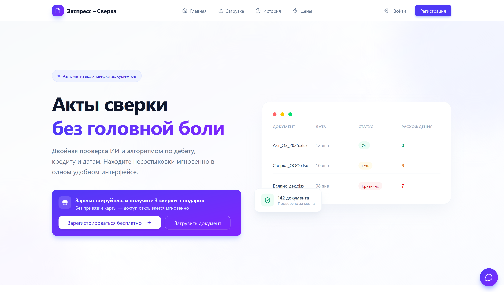
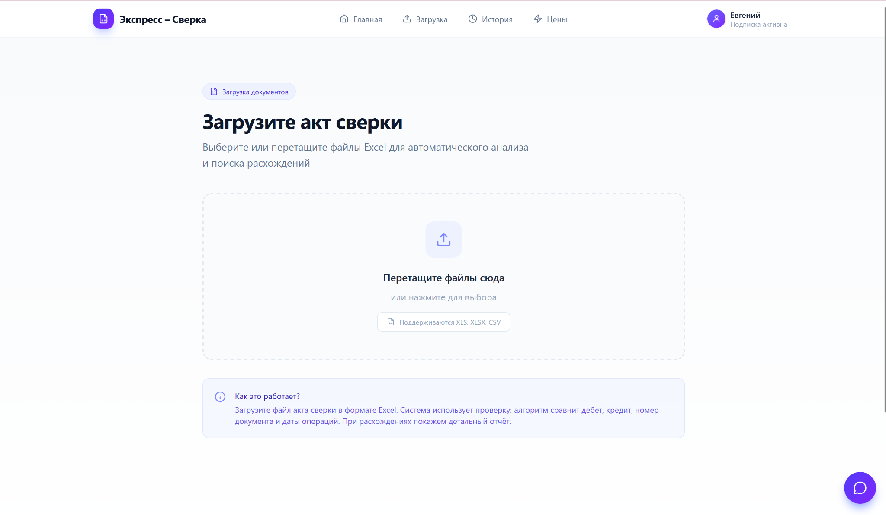
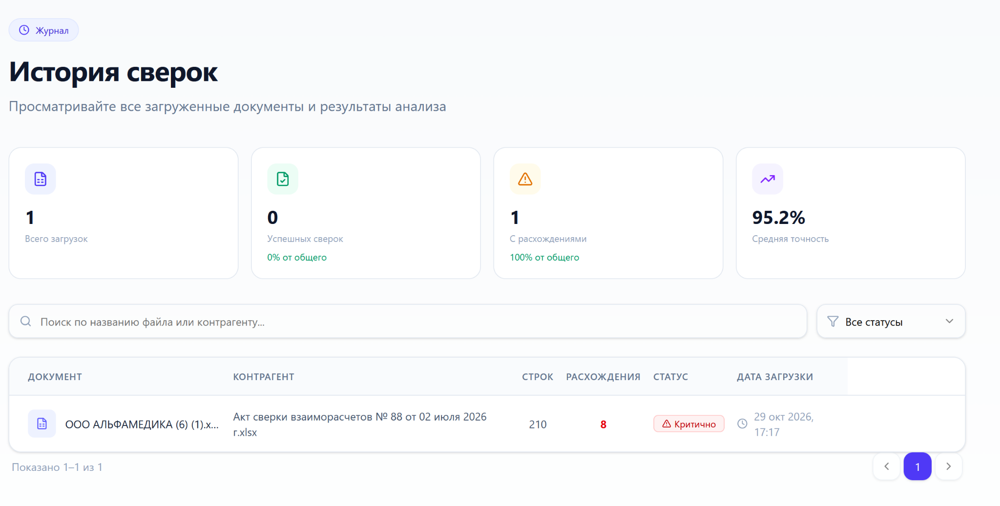
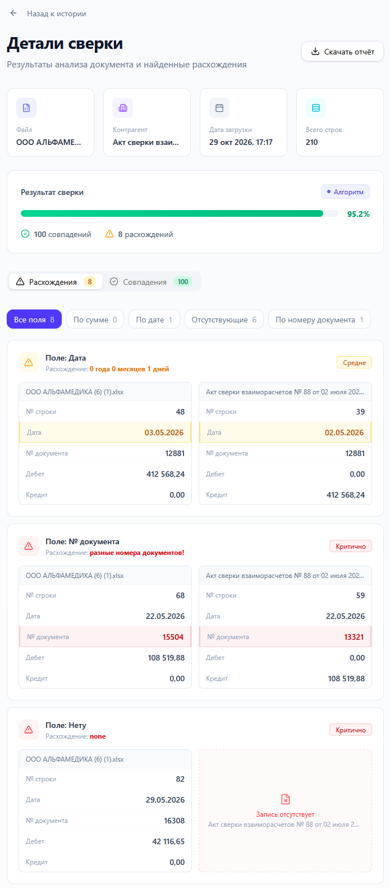
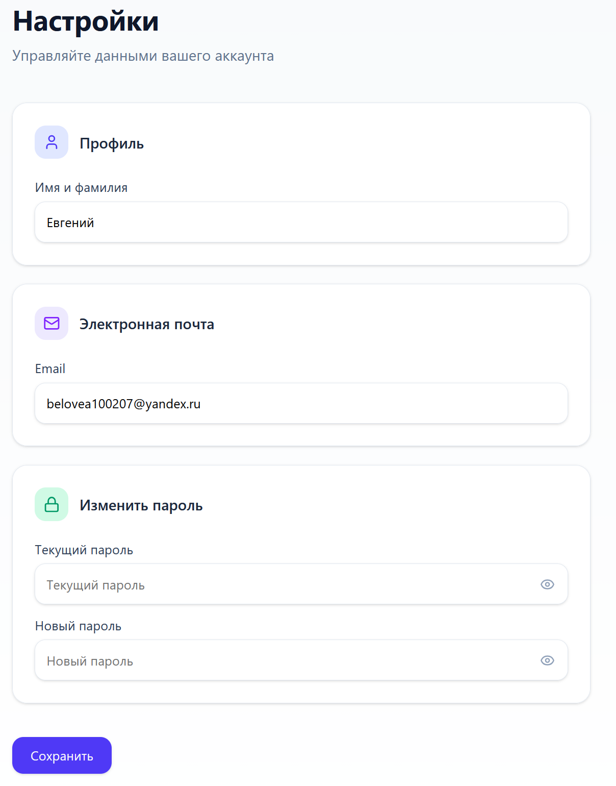
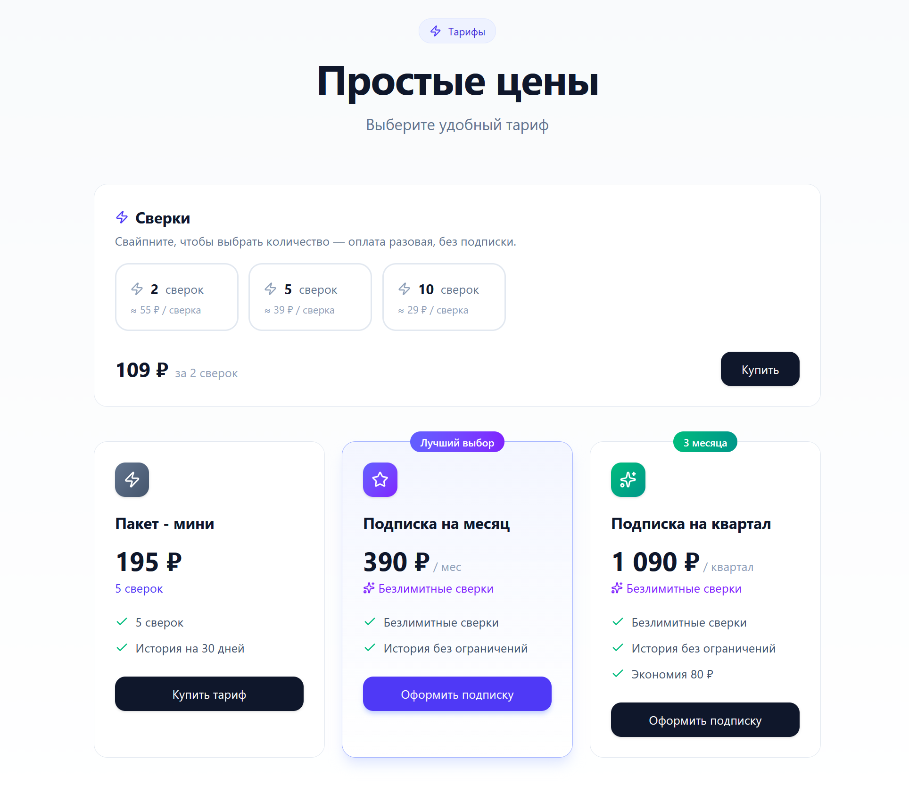
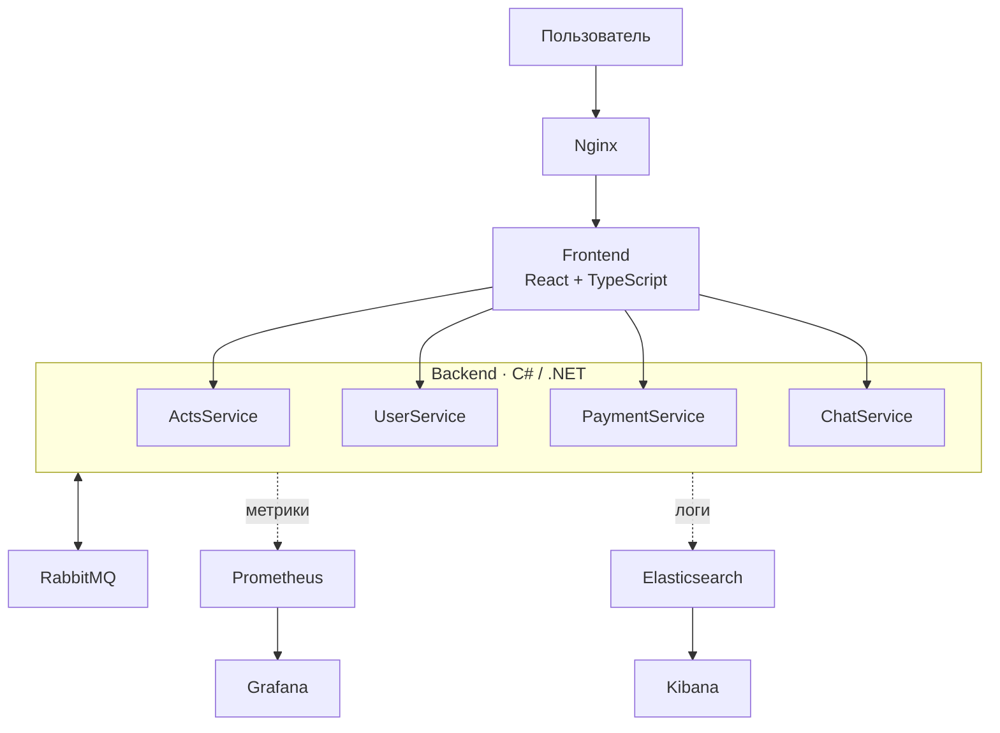

<div align="center">


<br>

<a href="https://express-sverka.ru/">
  
</a>
<a href="https://github.com/Zhenya848/ActsValidator">
  
</a>
<a href="https://github.com/Zhenya848/ActsValidatorFrontend">
  
</a>

<br><br>

**Сервис для автоматизированного сравнения двух актов взаиморасчётов.**  
Находит несовпадения, показывает проблемные строки и помогает быстрее разобраться в причинах расхождений.

[Демо-версия](https://express-sverka.ru/) ·
[Backend](https://github.com/Zhenya848/ActsValidator) ·
[Frontend](https://github.com/Zhenya848/ActsValidatorFrontend)

</div>

---

## Навигация

[О проекте](#-о-проекте) ·
[Возможности](#-возможности) ·
[Сценарий работы](#-как-это-работает) ·
[Интерфейс](#-интерфейс) ·
[Архитектура](#-архитектура-и-технологии) ·
[Запуск](#-запуск) ·
[Планы](#-текущий-статус-и-планы)

## ✦ О проекте

**Экспресс-Сверка (ActsValidator)** — веб-сервис, который автоматизирует первичную сверку актов взаиморасчётов между компанией и её контрагентом.

При ручном сравнении двух таблиц легко пропустить несовпадение в сумме, дате или номере документа. Сервис берёт на себя сравнение записей и формирует понятный результат: где данные совпали, где обнаружены различия и какие записи не удалось сопоставить.

Проект объединяет пользовательский интерфейс, набор backend-сервисов и инфраструктуру для развёртывания и наблюдаемости.

### Для кого

- **Бухгалтерия и финансовые отделы** — для регулярной сверки взаиморасчётов.
- **Компании, работающие с большим количеством контрагентов** — чтобы быстрее находить спорные записи.
- **Разработчики и интеграторы** — как основа для обсуждения автоматизации сверки в существующем процессе.

<table>
  <tr>
    <td width="33%" valign="top">
      <h3>01 · Меньше рутины</h3>
      Сравнение документов выполняется автоматически — не нужно вручную просматривать каждую строку.
    </td>
    <td width="33%" valign="top">
      <h3>02 · Понятные причины</h3>
      Результат показывает конкретные поля, строки и значения из обоих документов.
    </td>
    <td width="33%" valign="top">
      <h3>03 · Контроль истории</h3>
      Проверки сохраняются в журнале, а результат можно открыть повторно и скачать.
    </td>
  </tr>
</table>

## ⚡ Возможности

| Возможность | Что получает пользователь |
|---|---|
| Загрузка документов | Загрузка файлов XLS, XLSX и CSV через интерфейс сервиса |
| Сверка двух актов | Сопоставление записей по дебету, кредиту, дате и номеру документа |
| Поиск расхождений | Разделение результата на совпадения, несовпадения и отсутствующие записи |
| Детализация | Сравнение значений двух документов с указанием номеров строк |
| Категории ошибок | Просмотр расхождений по сумме, дате, номеру документа и отсутствующим записям |
| История проверок | Журнал загрузок, поиск по документу или контрагенту и фильтрация по статусу |
| Отчёт | Возможность скачать результат анализа |
| Аккаунт и тарифы | Профиль пользователя, пакеты сверок и варианты подписки |

## ⇢ Как это работает

<table>
  <tr>
    <td width="25%" align="center" valign="top">
      <h1>①</h1>
      <b>Загрузите</b><br>
      <sub>Добавьте два акта взаиморасчётов в поддерживаемом формате.</sub>
    </td>
    <td width="25%" align="center" valign="top">
      <h1>②</h1>
      <b>Дождитесь анализа</b><br>
      <sub>Сервис сопоставит записи по поддерживаемым полям.</sub>
    </td>
    <td width="25%" align="center" valign="top">
      <h1>③</h1>
      <b>Изучите результат</b><br>
      <sub>Посмотрите совпадения, различия и отсутствующие записи.</sub>
    </td>
    <td width="25%" align="center" valign="top">
      <h1>④</h1>
      <b>Скачайте отчёт</b><br>
      <sub>Откройте детали и сохраните результат проверки.</sub>
    </td>
  </tr>
</table>

## 🖥 Интерфейс

Ниже — реальные экраны приложения. Изображения сохранены в репозитории, поэтому они будут отображаться и в локальном предпросмотре, и на GitHub.

<table>
  <tr>
    <td width="50%" valign="top">
      <p align="center"><b>Главная страница</b></p>
      <a href="docs/screenshots/01-home.png">
        
      </a>
      <p><sub>Краткое описание сервиса и переход к основным действиям.</sub></p>
    </td>
    <td width="50%" valign="top">
      <p align="center"><b>Загрузка документов</b></p>
      <a href="docs/screenshots/02-upload.png">
        
      </a>
      <p><sub>Загрузка файлов для последующего анализа.</sub></p>
    </td>
  </tr>
  <tr>
    <td width="50%" valign="top">
      <p align="center"><b>История сверок</b></p>
      <a href="docs/screenshots/03-history.png">
        
      </a>
      <p><sub>Сводная статистика и список ранее загруженных документов.</sub></p>
    </td>
    <td width="50%" valign="top">
      <p align="center"><b>Детализация расхождений</b></p>
      <a href="docs/screenshots/04-comparison-details.png">
        
      </a>
      <p><sub>Сравнение строк двух документов и подсветка отличающихся полей.</sub></p>
    </td>
  </tr>
  <tr>
    <td width="50%" valign="top">
      <p align="center"><b>Настройки аккаунта</b></p>
      <a href="docs/screenshots/05-settings.png">
        
      </a>
      <p><sub>Профиль, электронная почта и управление паролем.</sub></p>
    </td>
    <td width="50%" valign="top">
      <p align="center"><b>Тарифы</b></p>
      <a href="docs/screenshots/06-pricing.png">
        
      </a>
      <p><sub>Пакеты сверок и варианты подписки.</sub></p>
    </td>
  </tr>
</table>

## 🧩 Архитектура и технологии

Проект разделён на frontend-приложение и backend-сервисы. Для запуска и сопровождения используются контейнеризация, брокер сообщений и инструменты наблюдаемости.

### Backend

**C# / .NET**

Backend организован по отдельным сервисам:

| Сервис | Назначение |
|---|---|
| `ActsService` | Работа с актами и логика сверки |
| `UserService` | Пользователи и данные аккаунта |
| `PaymentService` | Платежи и тарифы |
| `ChatService` | Функциональность чата |

### Frontend

**React 18 · TypeScript · Vite**

В клиентском приложении используются:

- Redux Toolkit и React Redux — состояние приложения;
- Material UI — компоненты интерфейса;
- React Router — маршрутизация;
- SignalR Client — взаимодействие в реальном времени;
- Tailwind CSS — стилизация.

### Инфраструктура

| Технология | Роль в проекте |
|---|---|
| Docker Compose | Запуск набора компонентов в контейнерах |
| Nginx | Reverse proxy и обслуживание frontend |
| RabbitMQ | Брокер сообщений |
| Prometheus + Grafana | Сбор и визуализация метрик |
| Elasticsearch + Kibana | Работа с логами и их просмотр |

### Логическая схема компонентов



<sub>Схема отражает логическое разбиение компонентов. Она не раскрывает внутренние маршруты API, конфигурацию очередей и детали реализации каждого сервиса.</sub>

## 🚀 Запуск

Развёртывание проекта выполняется через **Docker Compose**. В подготовленном окружении запуск компонентов выполняется одной командой:

```bash
docker compose up -d --build
```

Для запуска необходимы:

- Docker и Docker Compose;
- compose-конфигурация проекта;
- файлы настроек и переменные окружения для сервисов.

**Важно:** конфигурационные файлы, приватные параметры и секреты не публикуются в открытых репозиториях. Поэтому одного клонирования GitHub-репозиториев недостаточно для воспроизведения настроенного окружения. Команда выше предназначена для окружения, в котором необходимые конфиги и переменные уже подготовлены.

## 🛠 Текущий статус и планы

### Уже реализовано

- загрузка документов и запуск сверки;
- сравнение по дебету, кредиту, дате и номеру документа;
- отображение совпадений, расхождений и отсутствующих записей;
- подробный просмотр различий между строками;
- история загрузок и просмотр результатов;
- скачивание отчёта;
- пользовательский профиль и интерфейс тарифов.

### В развитии

- более устойчивое сопоставление записей при наличии дубликатов;
- приоритетный выбор наиболее подходящей записи при неоднозначном сопоставлении;
- расширение правил обработки нестандартных случаев;
- интеграция с 1С — после проверки реального спроса и требований к обмену данными.

> **Текущие ограничения:** интеграции с 1С пока нет. Обработка дубликатов и приоритетное сопоставление относятся к дальнейшему развитию и не заявляются как готовые функции.

## 🤝 Для бизнеса и сотрудничества

У компаний могут отличаться форматы выгрузок, правила сопоставления и требования к отчётам. Поэтому дальнейшее развитие сервиса предполагает проверку сценариев на обезличенных примерах документов и уточнение бизнес-правил.

Если вашей команде регулярно приходится сверять акты взаиморасчётов, можно начать со знакомства с текущей версией:

<div align="center">

<a href="https://express-sverka.ru/">
  
</a>

</div>

## 📦 Репозитории

| Часть проекта | Репозиторий |
|---|---|
| Backend | [Zhenya848/ActsValidator](https://github.com/Zhenya848/ActsValidator) |
| Frontend | [Zhenya848/ActsValidatorFrontend](https://github.com/Zhenya848/ActsValidatorFrontend) |
| Рабочая демо-версия | [express-sverka.ru](https://express-sverka.ru/) |

---

<div align="center">

**Экспресс-Сверка · ActsValidator**  
<sub>Автоматизация сверки актов взаиморасчётов</sub>

</div>
